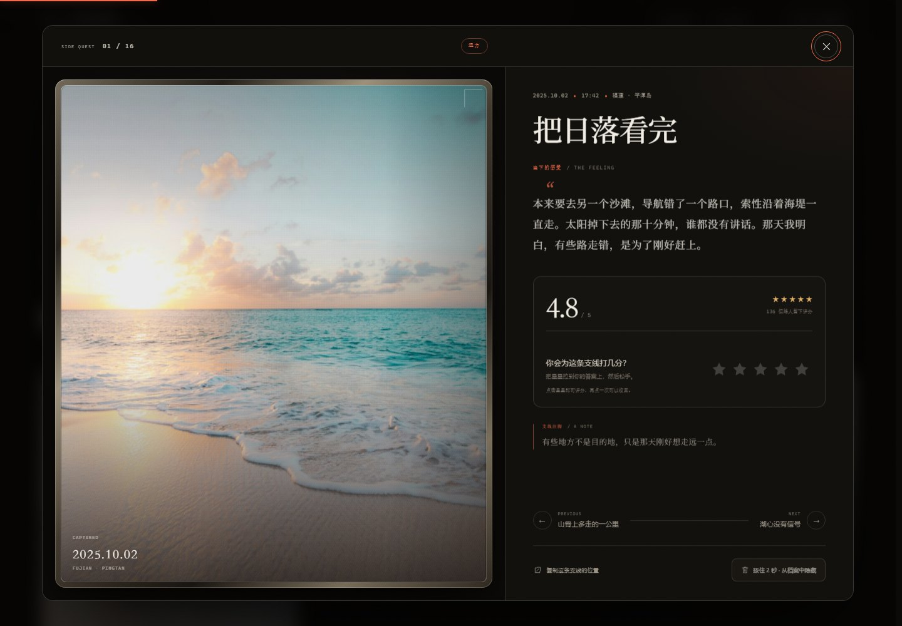
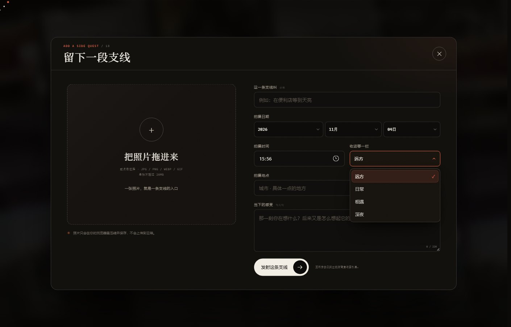

# 人生支线 · SIDE QUESTS

一个用来收集“偏航时刻”的个人影像档案。照片在背景中缓慢漂移，点击任意一张，会回到它发生的那一天：时间、地点、当下的感受，以及路过的人留下的评分。






## 本地预览

当前预览地址：

**http://127.0.0.1:4173/**

也可以双击 `start-preview.bat` 自动启动本地服务器并打开浏览器。如果端口被占用，关闭旧的命令行窗口后重试。

## 已实现的功能

- **Grid Motion 背景**：4 行斜向照片墙持续漂移，鼠标移动会带来轻微视差与逐张照片的点亮效果；每一张背景照片都能点击进入详情。
- **单图详情**：拍摄日期、时间、地点、当下的感受、分类注脚与照片编号；进入详情时照片会从索引卡片或背景照片的位置展开，内容再分层淡入。
- **Reflective Card 图片卡**：照片嵌在一张会随鼠标轻微倾斜的金属相片卡中，边缘有拉丝金属、移动高光与反光层，鼠标经过时会捕捉光线。
- **Peek Rating 评分**：鼠标悬停时星星会上浮、放大并显示评分标签，点击提交；再次点击同一颗星可收回评分。支持键盘方向键与屏幕阅读器。
- **Hold Button 删除**：在详情页底部按住 2 秒，隐藏预设支线或删除自己上传的支线；顶部会出现撤销提示。
- **Sling Button 上传入口**：首页右下角的圆形按钮可以点击，也可以向外拖拽后松开发射；打开上传窗口。
- **照片上传**：支持 JPG / PNG / WEBP / GIF / AVIF / BMP，拖拽或点击选择，单张最大 20MB。图片在浏览器本地压缩到最长边 1800px 后保存。
- **Glide Select 选择器**：图片类目使用滑动的 Glide Select；拍摄日期拆成年 / 月 / 日三个联动的 Glide Select，切换月份时会自动校正天数，菜单带高亮滑轨、方向键操作和视口边缘翻转。
- **筛选与索引**：全部 / 远方 / 日常 / 相遇 / 深夜，支持空状态与恢复隐藏内容。
- **辅助动效**：标题 BlurText 入场、卡片 3D 倾斜、点击火花（ClickSpark）、滚动揭示、数字递增、斜向 Marquee。
- **响应式**：桌面、平板与手机布局；支持 `prefers-reduced-motion`。

## 交互提示

| 操作 | 效果 |
| --- | --- |
| 点击背景任何照片 | 打开对应支线 |
| 点击索引卡片 | 打开对应支线 |
| 拖拽 / 点击右下圆形按钮 | 打开上传窗口 |
| 在详情页拖拽星星 | 预览分数并显示标签 |
| 点击星星 / 再点一次 | 提交评分 / 收回评分 |
| 类目或日期选择器：`↑` `↓` `Home` `End` | 在高亮行间移动 |
| 类目或日期选择器：`Enter` / `Space` | 确认选择 |
| 按住详情页底部按钮 2 秒 | 删除 / 隐藏支线 |
| 详情页 `←` / `→` | 上一条 / 下一条 |
| `Esc` | 关闭弹层 |
| 拖拽照片到上传框 | 选择照片 |

## 数据存储

这是一个纯静态本地网站，不需要后端即可预览：

- 评分记录：`localStorage`（键名 `sidequests.ratings.v1`）
- 被隐藏的预设支线：`localStorage`（键名 `sidequests.hidden.v1`）
- 用户上传的照片与文字：优先 IndexedDB；当浏览器禁用或阻塞 IndexedDB 时，自动降级到 `localStorage`。

因此，评分与上传数据只保存在**当前浏览器**中。页面里预置的“136 位路人”等评分是为了展示社区氛围的初始数据；如果要让不同设备上的访客共享真实评分，需要把 `localStorage` 替换成后端接口和数据库。

## 文件结构

```
网页设计/
├─ index.html               页面结构
├─ styles.css               视觉、动效与响应式
├─ app.js                   数据、背景、评分、上传、删除、路由
├─ start-preview.bat        一键启动本地预览
├─ preview-server.mjs       Node 备用静态服务器
├─ README.md
└─ assets/
   ├─ favicon.svg
   ├─ preview-home.jpg
   ├─ preview-detail.jpg
   ├─ preview-upload.jpg
   ├─ fonts/
   │  └─ noto-serif-sc-subset.woff2
   └─ photos/               16 张预设人生支线照片
```

## 修改内容

- 预设故事在 `app.js` 顶部的 `PRESETS` 数组中。每条记录包含标题、日期、地点、分类、感受、图片路径和初始评分。
- 色彩、字体、间距在 `styles.css` 顶部 `:root` 中统一控制。
- 如需替换照片，把图片放进 `assets/photos/`，再修改对应 `image` 路径即可。
- 上传照片会经过 `compressImage()` 处理，默认最长边 1800px、JPEG 质量 0.84。

## 制作参考

- 背景图片网格动效参考 [React Bits — Grid Motion](https://www.reactbits.dev/backgrounds/grid-motion)
- 详情图片卡片参考 [React Bits — Reflective Card](https://www.reactbits.dev/components/reflective-card)
- 长按删除按钮参考 [React Bits — Hold Button](https://www.reactbits.dev/micro/hold-button)
- 星星评分参考 [React Bits — Peek Rating](https://www.reactbits.dev/micro/peek-rating)
- 上传按钮参考 [React Bits — Sling Button](https://www.reactbits.dev/micro/sling-button)
- 类目与日期选择参考 [React Bits — Glide Select](https://www.reactbits.dev/micro/glide-select)
- 额外动效参考 React Bits 的 BlurText、TiltedCard、ClickSpark、AnimatedContent、CountUp、Marquee 等交互思路

所有动效均以原生 HTML / CSS / JavaScript 重写，无 React 或第三方运行依赖。

## 照片版权

预设照片来自 Unsplash，仅用于本作品的照片占位与课程演示。若公开发布，请替换为你自己拍摄的照片，或保留相应的 Unsplash 授权说明。
